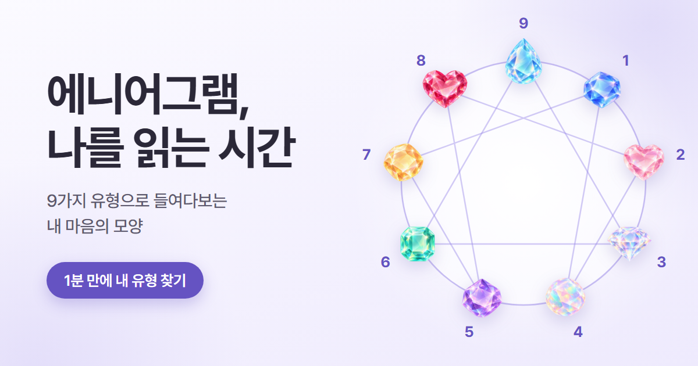
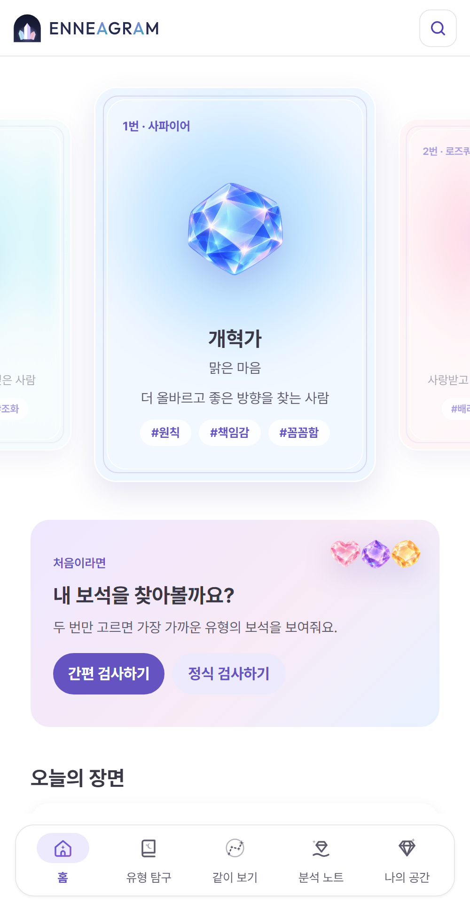
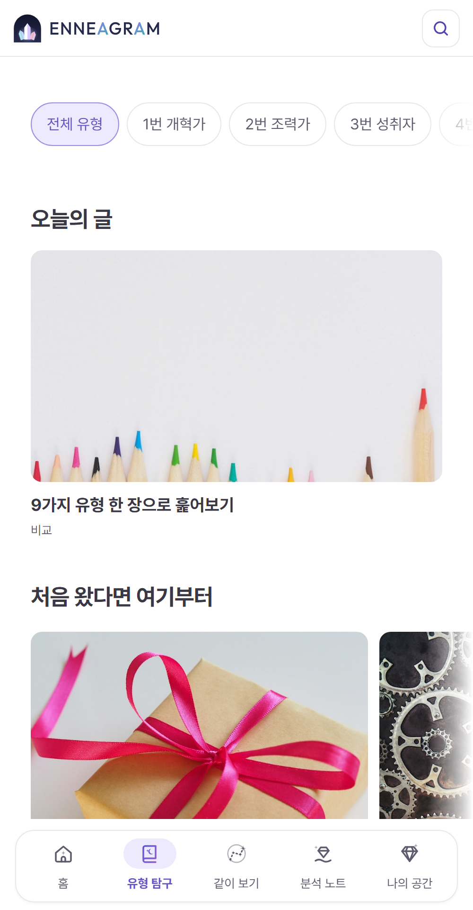
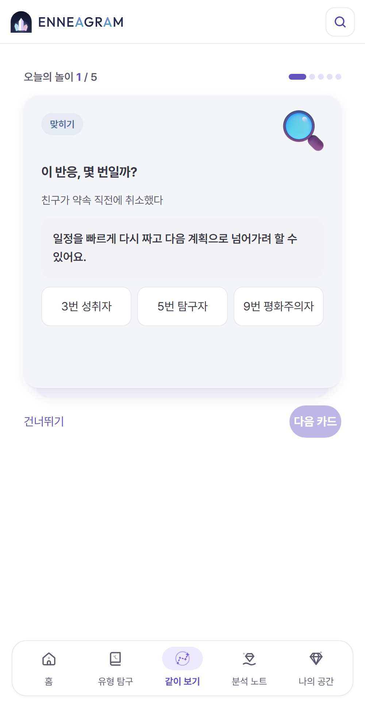
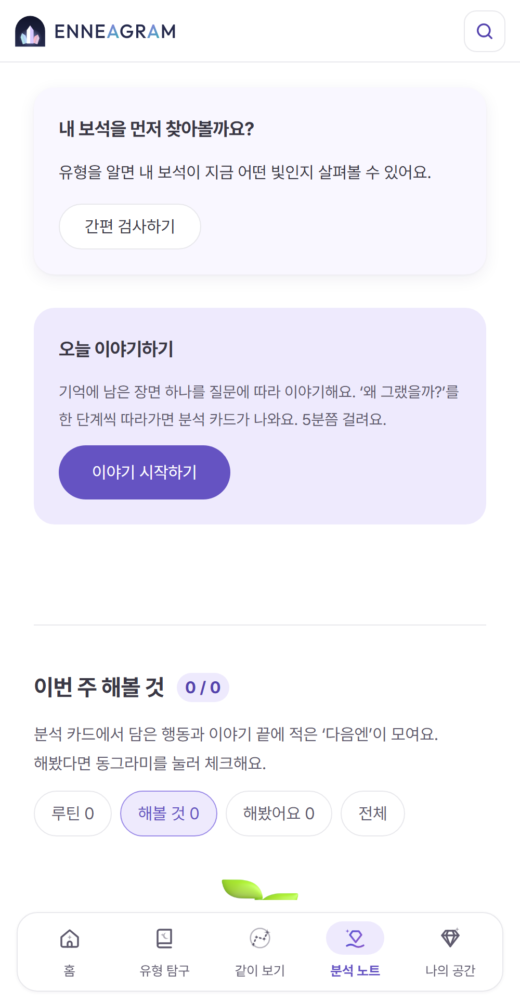
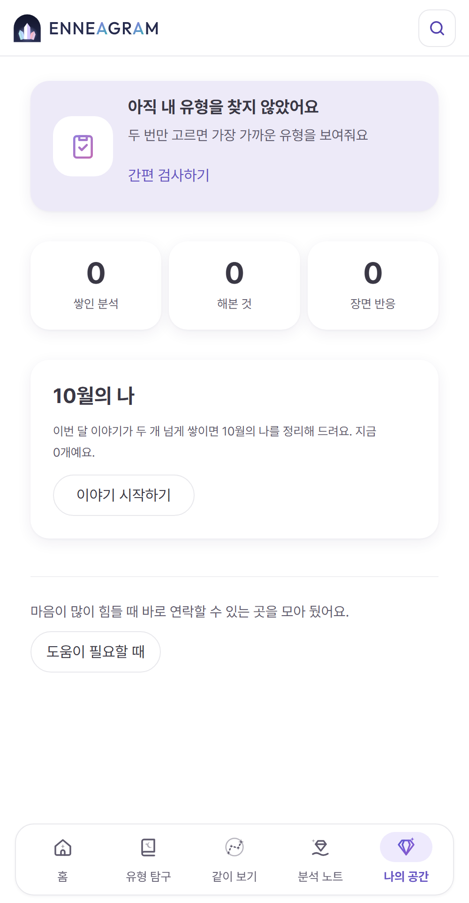

  

<h1 align="center">에니어그램 · 나를 읽는 시간</h1>

  9가지 유형을 보석으로 만나고, 오늘의 장면을 이야기하며 반복되는 내 패턴을 알아차리는 모바일 웹 서비스

---

## 어떤 서비스인가요

에니어그램 검사는 많지만 대부분 결과를 한 번 보고 끝나요. 이 서비스는 **유형을 맞히는 데서 끝내지 않고**, 일상의 장면을 쌓아 가며 *"아, 이게 내 패턴이구나"* 를 알아차리도록 돕습니다.

- **유형** — 9가지 유형을 보석(사파이어 ~ 아쿠아마린)으로 소개하고, 간편 · 정식 검사로 가까운 유형을 찾아요.
- **기록** — 오늘 있었던 장면을 질문에 따라 이야기하면 연마 처방전이 나오고, 쌓인 분석에서 반복되는 흐름이 보여요.
- **관계** — 같은 장면, 같은 질문에서 서로 다르게 반응하는 모습을 친구와 나란히 봐요. 궁합이나 점수는 없어요.

> 유형은 진단이 아니라 나를 관찰하는 틀이에요. 결과는 '확정'이 아니라 '가까운 후보'로 보여줍니다.

## 화면

<table>
  <tr>
    <td align="center"> <b>홈</b> 9가지 유형 카드 · 검사 · 오늘 할 것</td>
    <td align="center"> <b>유형 탐구</b> 주제별 글, 열 때마다 섞여요</td>
    <td align="center"> <b>같이 보기</b> 한 장씩 넘기는 오늘의 놀이 5장</td>
    <td align="center"> <b>분석 노트</b> 보석 상태 · 이야기하기 · 해볼 것</td>
    <td align="center"> <b>나의 공간</b> 내 유형 · 숫자 · 상태 변화 · 리포트</td>
  </tr>
</table>

## 하단 탭과 역할

| 탭 | 답하는 질문 | 주요 기능 |
|---|---|---|
| **홈** | 지금 뭘 하면 좋을까? | 9가지 유형 카드, 검사 배너, 오늘(보석 상태 · 이야기하기 · 해볼 것), 오늘의 장면, 오늘 읽을 글 |
| **유형 탐구** | 에니어그램과 9가지 유형은 어떤 걸까? | 주제별 글 줄(오늘의 글 · 헷갈릴 때 · 닮은 두 유형 …), 유형 요약 · 기초 · 비교 |
| **같이 보기** | 관계 속에서 나는 어떻게 반응할까? | 나라면? · 몇 번일까? · 닮은 두 유형 · 둘이서 질문 · 말 연습 · 오늘 물어볼 말 |
| **분석 노트** | 오늘 무슨 일이 있었고, 뭘 해볼까? | 보석 상태(20문항) → 오늘 이야기하기(채팅) → 이번 주 해볼 것 → 쌓인 분석 |
| **나의 공간** | 나는 어떤 사람이고, 무엇이 쌓였을까? | 내 유형 한 줄, 숫자 세 칸, 보석 상태 변화, ○월의 나, 도움이 필요할 때 |

## 만든 방식

- **정적 웹** — 서버 없이 HTML · CSS · JavaScript만으로 동작하는 모바일 웹이에요.
- **기록은 내 기기에만** — 검사 결과 · 이야기 · 해볼 것은 브라우저 `localStorage`에 저장해요. 기록 형식이 바뀌어도 예전 기록이 깨지지 않도록 버전과 옮기기(migration)를 함께 설계했어요.
- **링크로 나누기** — 친구와 비교 · 질문 카드는 주소에 필요한 값만 담아 보내요. 개인 기록은 공유하지 않아요.
- **디자인 토큰** — 색 · 글자 크기(6단계) · 반경(3단계)을 토큰 하나에서만 가져와 화면 전체의 일관성을 지켜요.
- **화면 회귀 검사** — 16개 화면 상태 × 5개 화면 폭을 자동으로 캡처해 수정 전후를 비교해요.

## 기획 · 설계 문서

화면을 만들기 전에 기준이 되는 문서를 먼저 정리하고, 그 기준에 맞춰 만들었어요.

| 문서 | 내용 |
|---|---|
| [제품 요구사항 (PRD)](docs/prd-v2.md) | 문제 정의, 대상 사용자, 기능 범위 |
| [사용자 리서치](docs/리서치_사용자와_질문.md) | 사용자 · 질문 설계 · 민감한 상황에서의 원칙 |
| [정보 구조 (IA)](docs/정보구조_IA.md) | 하단 탭 다섯 개의 역할과 새 기능 배치 규칙 |
| [UX 라이팅 가이드](docs/UX_라이팅_가이드.md) | 말투 · 용어 · 유형 이름 표준 |
| [UI 가이드](docs/UI_안티슬롭_가이드.md) | 컴포넌트 규칙과 제출 전 점검표 |
| [콘텐츠 가이드라인](docs/콘텐츠_가이드라인.md) | 유형 탐구 글의 형식과 작성 기준 |

## 출처

- 입체 이모지: [Fluent Emoji](https://github.com/microsoft/fluentui-emoji) (MIT) — [`assets/illust/LICENSE-fluentui-emoji.txt`](assets/illust/LICENSE-fluentui-emoji.txt)
- 사진: Unsplash — [`assets/photos/CREDITS.md`](assets/photos/CREDITS.md)
